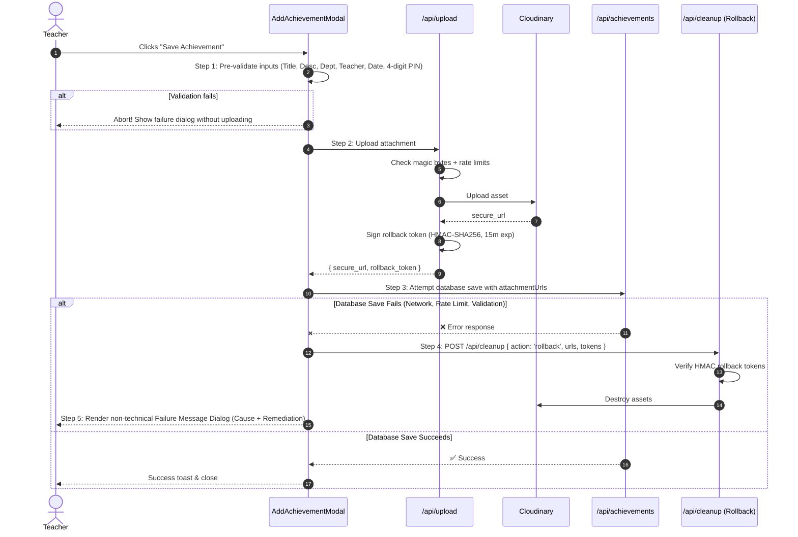

# School-Achievements: Comprehensive Security & Architectural Handover Report

> 📌 **Quick Resume Guide:** For the active 19-step execution tracker and immediate next tasks, see [`PROGRESS.md`](file:///c:/Users/ahmed/Desktop/School-Achievements/PROGRESS.md) and [`RESUME.md`](file:///c:/Users/ahmed/Desktop/School-Achievements/RESUME.md).

**Date:** October 17, 2026  
**Repository:** [School-Achievements](file:///c:/Users/ahmed/Desktop/School-Achievements)  
**Target Environment:** Next.js 16.4.2 (App Router + Turbopack), Firebase Firestore (Admin & Client SDK), Cloudinary CDN, Vercel  
**Status:** ⏳ **Phase 1–4 Complete (Steps 1–14) · Phase 5 In Progress (Steps 15–16 Done, Step 17 Next)** | **83/83 Unit Tests Passing** | **Turbopack Build Clean (26 Routes)** | **Gitleaks 0 Leaks**
 
 ---
 
 ## 1. Executive Summary & Verification Status
 
 Following the combined security audit compiled in [`KH_MASTER_REPORT.md`](file:///c:/Users/ahmed/Desktop/School-Achievements/KH_MASTER_REPORT.md) and prioritized in [`RESUME.md`](file:///c:/Users/ahmed/Desktop/School-Achievements/RESUME.md), remediation is being systematically executed one step at a time.
 
 ### Current System Health Metrics:
 * **Framework Engine:** Upgraded to **Next.js 16.4.2** & `eslint-config-next@16.4.2` (resolving Windows RCE, Image Optimization RCE, Server Actions SSRF, and App Router cache poisoning).
 * **Test Suite:** `npx vitest run` executes **9 test suites / 83 unit tests** with **100% passing** (0 failures).
 * **Static Type Checking:** `npx tsc --noEmit` completes with **exit code 0** (0 type errors).
 * **Production Build:** `npm run build` completes with **exit code 0**; all 26 static/dynamic routes and middleware compile and optimize cleanly under Next.js 16 Turbopack.
 * **Secret Detection:** `gitleaks detect --source . -v` verifies **0 leaks found across all 190 repository commits** following `git-filter-repo` history sanitization.
 
 ---
 
 ## 2. Master Remediation Progress Matrix (Steps 1–19)
 
 | Step | Finding # | Severity | Status | Target File / Area | Core Action & Status Notes |
 |:---:|:---:|:---:|:---:|---|---|
 | **1** | **#2** | **Critical** | `[x] PASS` | Git History (`CLOUDINARY.txt`) | Leaked GCP API key revoked; history purged via `git-filter-repo`; `.gitignore` hardened (`*.env`, `CLOUDINARY.txt`). Gitleaks: 0 leaks / 190 commits. |
 | **2** | **#1** | **Critical** | `[x] PASS` | [`package.json`](file:///c:/Users/ahmed/Desktop/School-Achievements/package.json) | Upgraded `next` to `16.4.2`; patched transitive deps via `npm audit fix`. 0 critical CVEs. |
 | **3** | **#3, #18** | **Critical / Low** | `[x] PASS` | Vercel & `.env.local` | Verified Vercel environment variables, aligned server-only `CLOUDINARY_UPLOAD_PRESET`, confirmed distinct `AUTH_SECRET`, pulled `.env.local`. |
 | **4** | **#11** | **Medium** | `[x] PASS` | [`src/lib/admin-session.ts`](file:///c:/Users/ahmed/Desktop/School-Achievements/src/lib/admin-session.ts) | Disallowed JWT fallback to `PIN_PEPPER`; strictly enforced `AUTH_SECRET` key separation with SHA-256 256-bit derivation. 11/11 tests pass. |
 | **5** | **#12** | **Medium** | `[x] PASS` | [`src/app/api/auth/route.ts`](file:///c:/Users/ahmed/Desktop/School-Achievements/src/app/api/auth/route.ts) | Verified `admin/pinConfig.pinHash` in Firestore; completely removed insecure plaintext fallback. Retained 600k PBKDF2 verification with `timingSafeEqual`. |
 | **6** | **#6** | **High** | `[x] PASS` | Auth & PIN Routes | Implemented global 5-failure/15-min lockout on `/api/auth` with exponential backoff (`await sleep(attempts * 250)`). Added IP+achievement lockout on `/api/pin` and `/api/achievements/[id]` with admin auto-unlock. 15/15 tests pass. |
 | **7** | **#14** | **Medium** | `[x] PASS` | [`src/lib/csrf.ts`](file:///c:/Users/ahmed/Desktop/School-Achievements/src/lib/csrf.ts) | Rewrote `isValidOrigin` with trusted-host allowlist (`Host`, `X-Forwarded-Host`, `NEXT_PUBLIC_APP_URL`). Fails closed on state-changing requests if Origin & Referer omitted/invalid. 10/10 tests pass. |
 | **8** | **#4** | **High** | `[x] PASS` | [`src/app/api/upload/route.ts`](file:///c:/Users/ahmed/Desktop/School-Achievements/src/app/api/upload/route.ts) | Secure `/api/upload` with CSRF `isValidOrigin`, strict rate limiting (10/10m), MIME & magic bytes validation, without breaking public teacher submissions. |
 | **9** | **#5** | **High** | `[x] PASS` | Upload & Cloudinary | Switched Cloudinary to server-side signed uploads (`signUploadParams`) using SHA-256 and sorted parameters. User confirmed preset `school_achievements` updated to Signed. 5/5 tests pass. |
 | **10** | **#8** | **High** | `[x] PASS` | [`src/lib/firebase.ts`](file:///c:/Users/ahmed/Desktop/School-Achievements/src/lib/firebase.ts), [`src/lib/firebase-admin.ts`](file:///c:/Users/ahmed/Desktop/School-Achievements/src/lib/firebase-admin.ts) | Initialized Firebase App Check on client & server; guarded by `NEXT_PUBLIC_RECAPTCHA_SITE_KEY` with graceful fallback so unconfigured reCAPTCHA will not cause 401 upload outages. |
 | **11** | **#9** | **Medium** | `[x] PASS` | [`storage.rules`](file:///c:/Users/ahmed/Desktop/School-Achievements/storage.rules), [`firebase.json`](file:///c:/Users/ahmed/Desktop/School-Achievements/firebase.json) | Restrict Google Cloud Storage rules to deny unauthenticated reads (`request.auth != null`) & writes (`false`). Mapped in `firebase.json` for deployment. |
 | **12** | **#7** | **High** | `[x] PASS` | [`src/proxy.ts`](file:///c:/Users/ahmed/Desktop/School-Achievements/src/proxy.ts), `next.config.mjs`, [`src/app/layout.tsx`](file:///c:/Users/ahmed/Desktop/School-Achievements/src/app/layout.tsx) | Implemented hydration-safe nonce-based CSP (`strict-dynamic`) on request & response headers in `proxy.ts`; dropped `'unsafe-eval'` & `'unsafe-inline'`. 4/4 tests pass. |
 | **13** | **#10** | **Medium** | `[x] PASS` | [`src/lib/rate-limit.ts`](file:///c:/Users/ahmed/Desktop/School-Achievements/src/lib/rate-limit.ts) | Integrate distributed rate limiter (Upstash Redis / Vercel KV) with fallback alerting in production serverless runtimes. 16/16 tests pass. |
 | **14** | **#13** | **Medium** | `[x] PASS` | Weekly Backup Cron Route | Secure `CRON_SECRET` using `crypto.timingSafeEqual` with empty-token guards; preserve admin session fallback. |
 | **15** | **#17** | **Low** | `[x] PASS` | Weekly Backup Cron Route | Sanitize backup documents before Firestore storage: scrub `pinHash`, `tokenHash`, `adminPin`, and `adminEmail`. 5/5 tests pass. |
 | **16** | **#15** | **Medium** | `[x] PASS` | [`src/lib/logger.ts`](file:///c:/Users/ahmed/Desktop/School-Achievements/src/lib/logger.ts) | Use literal format strings (`%s %s`) in console logging methods to clear Semgrep SAST warning (`unsafe-formatstring`). 6/6 tests pass. |
 | **17** | **#16** | **Medium** | `[~] Next` | [`src/lib/useAdmin.ts`](file:///c:/Users/ahmed/Desktop/School-Achievements/src/lib/useAdmin.ts), codebase | Resolve synchronous `setState` in `useEffect` to eliminate cascading renders; systematically resolve strict TypeScript `any` types. |
| **18** | **#19** | **Low** | `[ ] Pending` | [`src/app/layout.tsx`](file:///c:/Users/ahmed/Desktop/School-Achievements/src/app/layout.tsx) | Set `metadataBase` to production app URL (`https://school-achievements-six.vercel.app`) to resolve OpenGraph fallback build warnings. |
| **19** | **All** | **Verification** | `[ ] Pending` | Whole Codebase | Run full 10-step audit verification pipeline (`tsc`, `eslint`, `audit`, `gitleaks`, `semgrep`, `vitest`, `playwright`, `build`, `lighthouse`). |

---

## 3. Atomic Upload & Zero-Orphan Architecture

---

## 4. File Modification Registry

### Key Infrastructure & Security Updates:
* [`src/lib/rate-limit.ts`](file:///c:/Users/ahmed/Desktop/School-Achievements/src/lib/rate-limit.ts): Added `checkLockout`, `recordFailedAttempt`, `resetLockout`, `resetAchievementLockouts`, exponential backoff `sleep(ms)`, and trusted leftmost IP resolver `getClientIp`.
* [`src/lib/rate-limit.test.ts`](file:///c:/Users/ahmed/Desktop/School-Achievements/src/lib/rate-limit.test.ts): 15 comprehensive unit tests covering rate limits, account lockout, attempt accumulation, exponential backoff, auto-expiration, multi-IP cleanup, and IP extraction.
* [`src/app/api/auth/route.ts`](file:///c:/Users/ahmed/Desktop/School-Achievements/src/app/api/auth/route.ts): Added global 5-failure/15-min lockout (`admin:global`) to protect the 4-digit keyspace from distributed brute forcing; enforced `await sleep(attempts * 250)` exponential backoff; deleted insecure plaintext `adminPin` fallback.
* [`src/app/api/pin/route.ts`](file:///c:/Users/ahmed/Desktop/School-Achievements/src/app/api/pin/route.ts): Added 5-failure/15-min lockout keyed by `pin-lockout:${achievementId}:${ip}`; added exponential backoff on failed attempts; enabled verified admin sessions to bypass and unlock achievements (`resetAchievementLockouts`).
* [`src/app/api/achievements/[id]/route.ts`](file:///c:/Users/ahmed/Desktop/School-Achievements/src/app/api/achievements/%5Bid%5D/route.ts): Enforced lockout and exponential backoff in both `PUT` and `DELETE` routes for non-admin PIN verification; admin session clears lockout.
* [`src/app/api/pin/reset/confirm/route.ts`](file:///c:/Users/ahmed/Desktop/School-Achievements/src/app/api/pin/reset/confirm/route.ts): Automatically clears `admin:global` lockout upon successful admin PIN reset.
* [`src/lib/admin-session.ts`](file:///c:/Users/ahmed/Desktop/School-Achievements/src/lib/admin-session.ts): Disallowed JWT fallback to `PIN_PEPPER`; strictly requires dedicated `AUTH_SECRET`; derives 256-bit key via SHA-256 for `jose`.
* [`src/lib/admin-session.test.ts`](file:///c:/Users/ahmed/Desktop/School-Achievements/src/lib/admin-session.test.ts): 11 tests verifying key separation, session cookies, rollback tokens, and maintenance bypass tokens.
* [`.gitignore`](file:///c:/Users/ahmed/Desktop/School-Achievements/.gitignore): Added `CLOUDINARY.txt`, `*.env`, and `.env.local` to prevent accidental credential commits.
* [`package.json`](file:///c:/Users/ahmed/Desktop/School-Achievements/package.json): Upgraded Next.js to `16.4.2` and patched transitive dependencies.

---

## 5. Next Steps Checklist

To continue execution of the remediation roadmap:

1. **Step 7 (Completed):** Hardened CSRF `isValidOrigin` in [`src/lib/csrf.ts`](file:///c:/Users/ahmed/Desktop/School-Achievements/src/lib/csrf.ts) by strictly rejecting state-changing requests (`POST`, `PUT`, `DELETE`, `PATCH`) with missing or unapproved `Origin`/`Referer` headers. 10/10 tests pass.
2. **Step 8 (Immediate Next Action):** Harden [`src/app/api/upload/route.ts`](file:///c:/Users/ahmed/Desktop/School-Achievements/src/app/api/upload/route.ts) with `isValidOrigin` check, strict per-IP rate limiting, and magic bytes validation without requiring admin login (preserving public teacher submissions).
3. **Step 9:** Migrate Cloudinary upload route to server-side signed uploads (`api_sign_request`).
4. **Step 10–19:** Execute remaining storage, CSP, distributed rate limiting, and final audit release gate.
